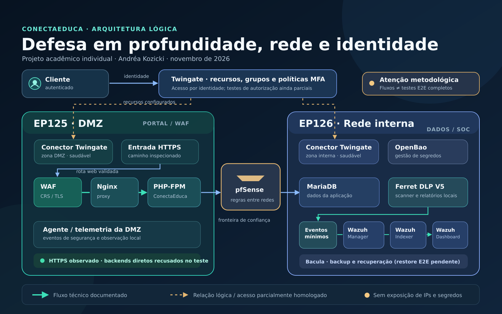
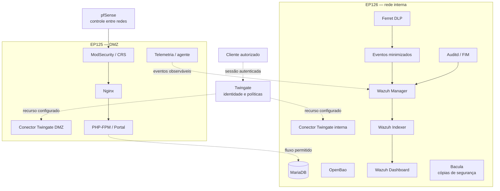
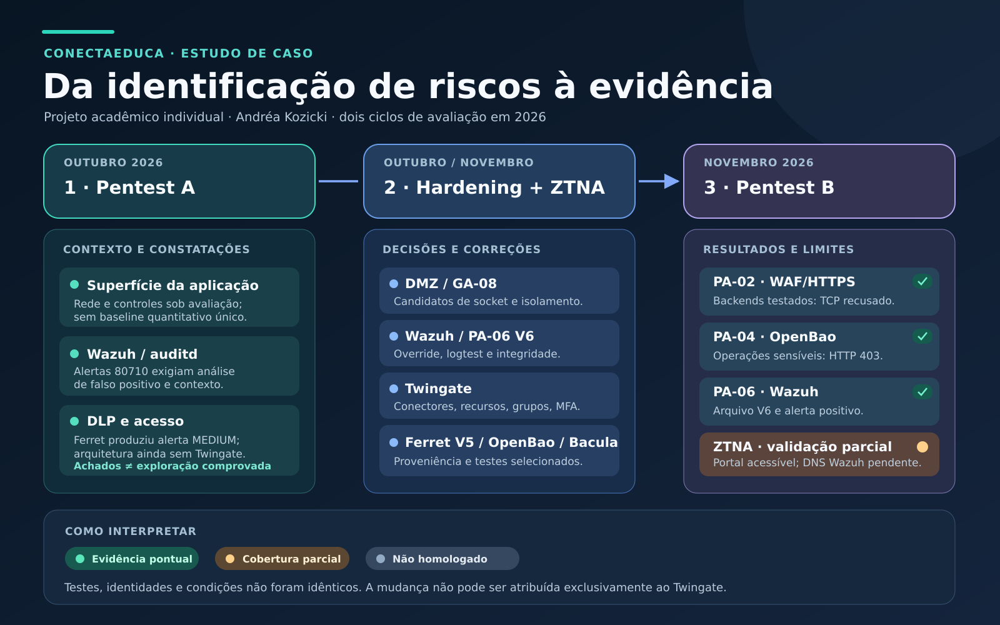

# ConectaEduca | Laboratório de Segurança da Informação

[](https://github.com/andrea-kozicki/conectaeduca/actions/workflows/phpunit.yml)
[](https://github.com/andrea-kozicki/conectaeduca/actions/workflows/semgrep.yml)
[](https://github.com/andrea-kozicki/conectaeduca/actions/workflows/gitleaks.yml)


**[English summary](README.en.md)** · [Minha atuação](#autoria-e-escopo-da-minha-atuação) · [Arquitetura](#arquitetura-do-laboratório) · [Estudos de caso](#três-estudos-de-caso) · [Pentests](#pentests-e-resultados) · [Evidências](docs/portfolio/EVIDENCIAS-PUBLICAS.md) · [Encerramento](docs/encerramento/README.md) · [Histórico](CHANGELOG.md)

O **ConectaEduca** começou como uma aplicação web acadêmica para oportunidades educacionais e evoluiu, na disciplina *Experiência Criativa 8* (2026), para um laboratório de **segurança de aplicações, redes, sistemas Linux e DevSecOps**.

O projeto reúne uma aplicação PHP, segmentação de rede, WAF, gestão de segredos, DLP, SIEM, backup e uma camada experimental de acesso Zero Trust. A evolução foi avaliada em **dois ciclos de pentest**, antes e depois da introdução do Twingate.

**Projeto acadêmico desenvolvido individualmente por Andréa Kozicki.** Atuei em arquitetura, integração, hardening, automação, execução dos testes, análise dos resultados e documentação. As VMs, a conectividade e o suporte à infraestrutura foram disponibilizados no contexto institucional da PUCPR; isso não representa coautoria do trabalho. Softwares e bibliotecas de terceiros mantêm suas respectivas autorias.

> **Estado de referência: 17/11/2026.** Este repositório apresenta código, infraestrutura declarativa, testes e decisões documentadas. É um **ambiente acadêmico, não um serviço de produção**. A existência de um controle no código, sua implantação em uma VM e sua validação ponta a ponta são estados distintos; as seções abaixo preservam essa diferença.

### Autoria e escopo da minha atuação

Desenvolvi o trabalho **sozinha**, do planejamento à apresentação do Pentest B, incluindo a articulação entre aplicação, DMZ, serviços internos, observabilidade, controles de acesso e avaliação ofensiva. As etapas executadas com restrições de privilégio ou dependentes da equipe de suporte estão identificadas como tal. Os registros de Git e os relatórios oferecem rastreabilidade técnica; não significam que todos os componentes externos tenham sido criados do zero.

**Para uma leitura rápida:** [arquitetura](#arquitetura-do-laboratório) → [três decisões técnicas](#três-estudos-de-caso) → [resultados e limites](#pentests-e-resultados) → [artefatos verificáveis](docs/portfolio/EVIDENCIAS-PUBLICAS.md) → [lições aprendidas](docs/portfolio/LESSONS_LEARNED.md).

## Visão executiva

| Eixo | O que foi construído ou exercitado | Evidência e ressalva |
| --- | --- | --- |
| **AppSec** | Autenticação local, RBAC, MFA TOTP, CSRF, limitação de tentativas e testes PHPUnit | Controles de aplicação validados em testes; não substituem auditoria externa |
| **Defesa em profundidade** | DMZ com ModSecurity/OWASP CRS, Nginx, PHP-FPM e segmentação pfSense | Acesso HTTPS observado; backends testados sem bypass direto |
| **Blue Team** | Wazuh, FIM, eventos auditd, YARA e integração sanitizada com Ferret | Regra 80710 V6 registrada com hash; cobertura de telemetria ainda parcial |
| **Segredos e resiliência** | OpenBao, MariaDB, Bacula e procedimentos de recuperação | Exercícios e healthchecks documentados; alguns restores E2E ficaram pendentes |
| **Zero Trust** | Twingate, conectores nas duas redes, grupos, recursos e políticas MFA | Configuração implantada; homologação completa de identidade/RBAC e acesso ao Wazuh não concluída |
| **Segurança ofensiva** | Pentest A (pré-ZTNA) e Pentest B (pós-ZTNA), com sete pontos de ameaça (PAs) | Escopo executado com diferentes graus de profundidade; sem alegação de cobertura total |
| **DevSecOps** | CI, testes, SAST, SCA, análise de segredos e integridade de artefatos | PRs e gates reproduzíveis; reconciliação final do runtime ainda separada |

## Arquitetura do laboratório

O laboratório utilizou duas VMs Ubuntu 24.04, com fronteiras de confiança distintas. **EP125** hospedou os componentes da DMZ e **EP126**, os serviços internos. O pfSense controlou a comunicação entre zonas. Os elementos abaixo representam a arquitetura lógica, não um inventário de todas as portas ou uma promessa de conectividade universal.

[](docs/portfolio/assets/arquitetura-seguranca.svg)

*Infográfico de arquitetura. Clique para abrir a [versão vetorial ampliável](docs/portfolio/assets/arquitetura-seguranca.svg); o diagrama Mermaid editável segue abaixo.*



### Fronteiras e decisões de segurança

- A **DMZ** expõe o caminho web por WAF; Nginx e PHP-FPM não são pontos de entrada públicos independentes no desenho endurecido.
- As comunicações **DMZ ↔ rede interna** são permitidas por regras específicas do pfSense, não por uma rede Docker compartilhada entre VMs.
- Segredos e certificados operacionais são mantidos fora do Git; o OpenBao foi usado em cenários com políticas de acesso restritas.
- O **Ferret** processa dados localmente, e a integração com o Wazuh utiliza eventos minimizados, evitando publicar relatórios DLP brutos no SIEM.
- O **Twingate** acrescenta uma camada de acesso por identidade para recursos definidos. Sua presença não comprova, por si só, que todas as rotas legadas foram eliminadas ou que todas as políticas foram homologadas.

Mais detalhes: [arquitetura de VMs](deploy/ARQUITETURA-VMs.md), [fluxos de dados](docs/dfd.md) e [modelo de ameaças STRIDE](docs/stride.md).

O diagrama distingue **acesso por identidade**, **fronteiras de rede**, **tráfego de aplicação** e **telemetria**. As setas pontilhadas representam relações lógicas ou fluxos restritos, não uma captura de pacotes; a resolução DNS do Wazuh via Twingate permaneceu pendente.

## Três estudos de caso

### 1. DMZ: restringir o caminho de entrada sem quebrar o portal

- **Problema:** os caminhos diretos aos backends poderiam contornar a inspeção do WAF se permanecessem expostos.
- **Intervenção:** organizei configurações candidatas de socket/isolamento para Nginx e PHP-FPM (GA-08), preservei a composição do WAF e planejei validações e rollback.
- **Observação:** na EP125, a cadeia WAF → Nginx → PHP permaneceu saudável; o endpoint HTTPS respondeu, enquanto as portas backend `8080`/`9000` testadas recusaram a conexão.
- **Limite:** verificação circunscrita à janela, origem e superfície testadas; parte dos candidatos GA-08 ainda não estava reconciliada com a `main`.

### 2. Blue Team: tornar a detecção Wazuh 80710 verificável

- **Problema:** a análise da regra 80710 exigia diferenciar uma mudança real de modo promíscuo de condições de falso positivo.
- **Intervenção:** validei o override V6 baseado nos campos auditd, exercitei o `logtest`, confrontei a integridade do XML e documentei a proveniência do arquivo aplicado.
- **Observação:** manager saudável, arquivo V6 com SHA-256 verificado e alerta positivo 80710 registrado após a alteração.
- **Limite:** a publicação do XML na PR #240 é *source-only*; não demonstra, por si, cobertura E2E integral nem o comportamento negativo em todas as condições.

### 3. Zero Trust: da configuração à prova de autorização

- **Problema:** a segmentação de rede não substitui decisões de acesso baseadas em identidade e contexto.
- **Intervenção:** configurei recursos, grupos, políticas de MFA e conectores Twingate nas duas zonas, e testei clientes Linux/Android.
- **Observação:** conectores saudáveis e acesso autenticado ao portal em cenários específicos.
- **Limite:** o alias do Dashboard Wazuh apresentou falha DNS; não houve homologação conclusiva de matriz `allow/deny` e MFA para identidades distintas.

Esses casos mostram **o que fiz, como medi e o que ainda não posso afirmar**. A documentação pública detalha os [artefatos e as lacunas](docs/portfolio/EVIDENCIAS-PUBLICAS.md).

## Evolução: dois pentests e Zero Trust

[](docs/portfolio/assets/evolucao-pentest.svg)

*Comparação qualitativa. A [versão vetorial](docs/portfolio/assets/evolucao-pentest.svg) distingue o que foi observado do que permaneceu parcial; as tabelas abaixo detalham os limites.*

| Fase | Recorte | Aprendizado principal |
| --- | --- | --- |
| **Pentest A — outubro/2026** | Arquitetura segmentada **antes** do Twingate; cenários internos e de aplicação | Identificação de pontos de exposição e lacunas de detecção, autorização e observabilidade |
| **Endurecimento + Zero Trust — outubro/novembro** | Ajustes de WAF, Ferret, Wazuh, OpenBao e implantação experimental do Twingate | Mudanças estruturais e operacionais documentadas; nem todas foram homologadas em todas as identidades |
| **Pentest B — novembro/2026** | Retestes a partir de identidade limitada nas redes DMZ/interna, após a introdução do Twingate | Comparação dos comportamentos observados, inclusive negativas de acesso e limites do próprio teste |

**Atenção metodológica:** os cenários, identidades e condições não foram idênticos em todos os retestes. Portanto, uma diferença entre A e B **não deve ser atribuída exclusivamente ao Twingate**. Também não se deve confundir “PA executado” com “exploração bem-sucedida” ou “controle totalmente homologado”.

| Recorte comparável | Antes / Pentest A | Depois / Pentest B | Leitura responsável |
| --- | --- | --- | --- |
| Exposição de backends | Inventário inicial de superfícies e controles da DMZ | `8080`/`9000` recusados nos testes da EP125 | Evidência pontual de isolamento no B, não medição universal de redução |
| Detecção Wazuh | Alertas da regra 80710 e necessidade de qualificar falsos positivos | Override V6 validado; alerta positivo pós-ajuste | Mudança verificável, sem calcular taxa de falso positivo comparativa |
| Controle por identidade | Arquitetura anterior ao Twingate | Políticas/conectores configurados e cliente autenticado | A implementação progrediu; RBAC/MFA completo não foi provado |

Para a comparação dos **sete** pontos, consulte a [matriz pública por evidência e restrição](docs/portfolio/EVIDENCIAS-PUBLICAS.md).

### Pentests e resultados

Os exercícios foram organizados em **sete pontos de ameaça (PA-01 a PA-07)**, com coleta de evidências nas duas redes. A matriz abaixo resume exemplos representativos, sem substituir os relatórios integrais:

| Ponto | Ativo/controle | Resultado demonstrado | Limite |
| --- | --- | --- | --- |
| **PA-01** | Reconhecimento e metadados | Enumeração restrita ao contexto autorizado | Não representa exploração |
| **PA-02** | Portal, TLS e WAF na DMZ | HTTPS observado; tentativas diretas aos backends testados retornaram recusa | Cobertura restrita às rotas, portas e origens testadas |
| **PA-03** | Privilégios locais na rede interna | Identificado wrapper institucional em `/usr/local/bin/sudo` com modo `0777`; escrita efetiva não foi demonstrada | Não houve comprovação de escalada de privilégios; analisar também atributos/proteções do arquivo |
| **PA-04** | OpenBao e políticas | Identidade de teste com acesso mínimo; operações sensíveis retornaram `403` | Não equivale a auditoria completa de RBAC |
| **PA-05** | Inscrições/autorização | Rotas e respostas HTTP observadas | Ausência de contas adequadas limitou os testes BOLA/IDOR |
| **PA-06** | Wazuh/auditd | Override V6 da regra 80710 e alerta pós-correção documentados | Correlação E2E negativa e cobertura global de telemetria não concluídas |
| **PA-07** | DLP, backup e saída de dados | Ferret/Bacula e superfícies operacionais inspecionados | Interface DLP e restauração não receberam reteste funcional completo |

As evidências brutas podem conter identificadores ou detalhes de laboratório e **não são publicadas indiscriminadamente**. Um recorte público deve ser sanitizado e autorizado.

## Zero Trust: o que foi comprovado e o que ficou aberto

- **Implantado/observado:** conectores Twingate nas redes interna e DMZ, recursos/grupos configurados, clientes autenticados e políticas de acesso/MFA cadastradas.
- **Observado no portal:** acesso à aplicação a partir de cliente autenticado em testes específicos.
- **Limitação registrada:** o alias do Wazuh Dashboard apresentou problema de resolução DNS em clientes testados; isso impede declarar o acesso ao Dashboard plenamente homologado.
- **Pendente:** testar sistematicamente `allow/deny`, MFA efetivo e segregação de funções com identidades distintas, além de confrontar caminhos legados e políticas pretendidas.

O objetivo foi avaliar **redução de superfície e controle de acesso**, não afirmar que a simples adoção de um produto satisfaz integralmente os princípios Zero Trust.

## Correções rastreáveis no GitHub

| Entrega | O que está registrado | Alcance da evidência |
| --- | --- | --- |
| [PR #237](https://github.com/andrea-kozicki/conectaeduca/pull/237) — Ferret V5 / GA-06 | Override, proveniência e validadores offline da imagem | Fonte reconciliada; nenhum deploy provocado pelo merge |
| [PR #240](https://github.com/andrea-kozicki/conectaeduca/pull/240) — Wazuh 80710 V6 / PA-06 | XML literal da EP126, SHA-256 e validação estática em CI | Identidade do arquivo comprovada; não substitui reteste funcional |
| [PR #238](https://github.com/andrea-kozicki/conectaeduca/pull/238) — dependência | Atualização de segurança do phpseclib | Alteração versionada e submetida aos gates de CI |

Para o Wazuh V6, a cópia versionada correspondeu ao SHA-256 documentado no runtime:

```text
4da3e4fe32a151f058c6d646340e8fc8a410e7bcfd41124207830cfc7e691ecf
```

Leia os registros completos em [GA-06 / Ferret](docs/release/GA06-RECONCILIACAO-EP126.md) e [PA-06 / Wazuh V6](docs/release/PA06-WAZUH-80710-V6-EP126.md).

As [PRs ainda em rascunho](docs/portfolio/PR_TRIAGE.md) são trabalho em análise; **não** devem ser confundidas com mudanças publicadas na `main` nem com implantações homologadas.

## DevSecOps e validação

O repositório utiliza, conforme o workflow, **PHPUnit, Composer Audit, Semgrep, Gitleaks, Snyk, verificações estáticas e validação de proveniência**. Há controles de permissões, integridade e preparação fail-closed em scripts selecionados.

Para validar somente o código em um ambiente de desenvolvimento compatível, sem implantar a infraestrutura das VMs:

```bash
composer validate --strict --no-check-publish
composer audit --locked --no-interaction
composer install --no-interaction --prefer-dist --no-progress
vendor/bin/phpunit
python3 scripts/evidencias/pa06_validar_80710_v6.py
```

Os scripts relacionados ao Ferret V5 também validam artefatos locais, mas exigem uma imagem TAR sob custódia apropriada: **o TAR institucional não é distribuído neste repositório**. Não execute scripts de implantação, rollback ou recuperação em produção com base apenas neste README.

Consulte [scripts de evidência](scripts/evidencias/README.md), [requisitos de segurança](docs/requisitos-seguranca-asvs.md) e [evolução da arquitetura](docs/EVOLUCAO-ARQUITETURA-EC8.md) para contexto histórico.

## Estrutura e navegação

| Caminho | Conteúdo |
| --- | --- |
| `public/`, `src/`, `tests/` | Aplicação PHP, domínio e testes |
| `deploy/dmz/` | WAF, Nginx, PHP-FPM e definições de DMZ |
| `deploy/interna/` | OpenBao, MariaDB, Ferret, Wazuh e Bacula |
| `deploy/pfsense/` | Segmentação e documentação de perímetro |
| `ops/`, `scripts/` | Operação controlada, validadores e evidências |
| `docs/` | Threat model, requisitos, decisões, relatórios e histórico |
| `.github/workflows/` | Integração contínua e verificações de segurança |

**Guias do portfólio:** [evidências públicas](docs/portfolio/EVIDENCIAS-PUBLICAS.md) · [lições aprendidas](docs/portfolio/LESSONS_LEARNED.md) · [triagem de PRs](docs/portfolio/PR_TRIAGE.md) · [privacidade e publicação](docs/portfolio/PRIVACIDADE-E-PUBLICACAO.md) · [preservação da EP125](docs/portfolio/EP125-PRE-ENCERRAMENTO.md) · [reporte responsável](SECURITY.md).

## Limitações e riscos residuais

1. **Reconciliação de fontes ≠ paridade integral do runtime.** A `main` contém correções confirmadas, mas checkouts operacionais e arquivos locais das VMs ainda tinham diferenças no último inventário.
2. **EP125/GA-08:** havia scripts e candidatos de configuração locais ainda não totalmente conciliados no GitHub; não presumir que a `main` reproduz todo o cutover.
3. **Zero Trust:** política configurada não equivale a decisão de autorização/MFA comprovada para todos os grupos, recursos e dispositivos.
4. **Pentests:** várias verificações foram parciais por restrições de identidade, infraestrutura, tempo ou autorização.
5. **Backup:** healthcheck de contêiner não prova restauração ponta a ponta; recuperação continua dependente de infraestrutura e custódia adequadas.
6. **Reprodutibilidade:** o laboratório dependeu de pfSense, rede e suporte institucionais. Ele não pode ser iniciado integralmente apenas com `docker compose up`.

O ambiente acadêmico tinha previsão de encerramento ao final do semestre de 2026. A continuidade pública do trabalho prioriza **código, metodologia, validação estática e evidências sanitizadas**, não a exposição de credenciais, dumps, snapshots ou configurações específicas da instituição.

## Uso responsável e atribuições

Este é um **projeto acadêmico conduzido individualmente por Andréa Kozicki**, com apoio de infraestrutura e suporte institucionais, componentes de terceiros e contribuições técnicas rastreadas no Git. As evidências refletem os cenários, permissões e datas dos testes; não constituem certificação de segurança de um serviço real.

Não publique dados pessoais, segredos, chaves privadas ou evidências institucionais sem a autorização correspondente. A ausência de uma licença explícita não deve ser interpretada como autorização genérica de reutilização de código ou infraestrutura.
