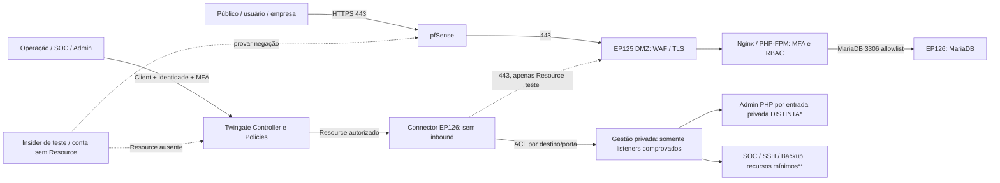

# ConectaEduca — arquitetura-alvo Zero Trust da Fase 3

> **Proposta documentada, NÃO implantada.** Baseline: EP125 (DMZ/WAF/PHP), EP126 (dados/SOC/cofre/backup), pfSense. Pentest A encerrado. Meta de implantação e freeze: **07/11/2026**; pentest B: **08–14/11**; apresentação **17/11**.

## 1. O que fica e o que muda

**Preservar:** WAF HTTPS EP125:443, Nginx/PHP-FPM, MariaDB EP126:3306 somente do PHP, RBAC/MFA/sessões/CSRF da aplicação, regras pfSense, OpenBao/Wazuh/Bacula e suas restrições próprias. Público e empresas continuam navegando o site pela **porta 443 padrão**, sem precisar instalar Client; inscrições continuam exigindo login.

**Acrescentar:** Twingate como ZTNA para **recursos privados de gestão**, separados por identidade, grupo, política com MFA e destino host/porta explícitos; não abrir NAT novo para serviços internos. Twingate não substitui proteção do serviço nem impede movimento lateral por si só quando o atacante já está dentro de uma VM.

**Cuidado decisivo:** Twingate controla **FQDN/IP e portas**, não caminhos HTTP. Um Resource para `192.168.6.34:443` não diferencia `/admin`, `/empresa` e `/oportunidades`. Criar grupo Twingate para essa mesma porta **não isola a área administrativa** enquanto a rota pública continuar chegando a `/admin`. Para isolar Administração PHP, será necessário um **endpoint privado de rede realmente distinto**, com o caminho público `/admin` negado no WAF/proxy, mais defesa em profundidade no PHP.

## 2. Diagrama lógico (alvo, não representa mudanças ativas)

`*` Entrada privada administrativa precisa ser projetada e testada: **não existe no baseline**. `**` Recursos de gestão só podem ser cadastrados depois de medir listener, rota, TLS, autorização e ACLs reais.

## 3. Grupos e matriz de menor privilégio

| Público/grupo Twingate | Acesso permitido | Negação que deve ser comprovada |
|---|---|---|
| Visitante, `usuario` e `empresa` (papéis da aplicação, **sem Twingate**) | Site HTTPS 443; recursos PHP conforme RBAC; inscrição exige login | OpenBao, Wazuh, backups, SSH, MariaDB e áreas PHP sem papel |
| `TG-OPERACAO` | Gestão operacional de recursos pontuais, inicialmente SSH EP126:22 **somente se listener/host ACL forem verificados** | OpenBao, Catalog, painéis de segurança sem permissão |
| `TG-SEGURANCA` | Wazuh Dashboard HTTPS **porta e binding a identificar**, eventual SSH controlado | Banco de dados, backup e cofre por padrão |
| `TG-ADMIN` | Administração das VMs sob MFA e recursos mínimos; entrada privada Admin PHP **após implantada** | Nada de sub-rede inteira, portas curingas ou serviços implícitos |
| `TG-BACKUP` (se necessário) | Bacularis HTTPS privado ou SSH administrativo pontual, **somente se endpoint comprovado** | Bacula 9101/9102/9103 e PostgreSQL 5432 não ficam expostos como Resources |
| Conta sem grupo / insider de teste | Nenhum Resource privado atribuído | Todos os Resources privados |

**Separação fundamental:** `usuario`, `empresa`, `admin` são papéis **RBAC PHP**; grupos `TG-*` são identidades **Twingate**. Não conceder acesso à rede interna a todo `admin` PHP automaticamente. O papel `admin` PHP não significa que a pessoa é administradora de servidores.

## 4. Resources/portas por porção da infraestrutura

| Resource | Destino lógico | Porta | Situação/gate |
|---|---|---|---|
| WEB-PUBLIC | WAF EP125 `192.168.6.34` | TCP 443 | Existente e público; não depender de Twingate |
| WEB-TUNNEL-TEST | Mesmo WAF | TCP 443 | **Opcional** para teste positivo ZT; **não demonstra isolamento de /admin** |
| MGMT-EP126-SSH | EP126 host | TCP 22 | Proposto; requer listener, autorização, reachability e host firewall |
| MGMT-EP125-SSH | EP125 host | TCP 22 | Proposto; requer nova prova de rota/ACL, hoje interzona bloqueado |
| SOC-DASHBOARD | Interface Wazuh privada | TCP 443 **se confirmado** | Proposto; não inventar listener, não publicar interface em DMZ |
| BK-BACULARIS | Interface Bacularis privada | Porta TLS **a identificar** | Proposto; não conceder PgBouncer/Catalog/Bacula diretamente |
| APP-ADMIN-PRIVADO | Entrada HTTPS administrativa **IP/listener de rede distinto do público** | TCP 443 desejável | **Não implantado**; bloquear rota pública `/admin` de forma verificável antes de alegar isolamento |
| OPENBAO / MariaDB / Catalog | Serviços internos | Nenhuma porta Twingate atribuída | Negar, usar caminhos de administração controlada |

### Decisão de design obrigatória: área PHP `/admin`

É insuficiente apontar `admin.conectaeduca.local` ao mesmo IP:443 do WAF público. Para isolamento real, implementar **um endpoint de rede privado diferente**, exposto exclusivamente para o Connector, com uma das alternativas analisadas e validadas com o laboratório: (A) listener/IP privado adicional no WAF EP125, firewall restringindo a origem e regra de negação da rota pública; (B) proxy privado em EP126 com binding/TLS/ACL próprios e caminho controlado ao WAF, mantendo `/admin` inacessível pela rota pública. A solução escolhida requer desenho detalhado, hostname/SAN e regras **antes** da implantação. Se for impossível, registrar como limite: **ZTNA de gestão implantado, porém `/admin` ainda protegido somente por WAF/RBAC/MFA, sem isolamento de rede exclusivo.**

## 5. Restrições, dependências e riscos

- **EP126-F2-0014, 21/10:** Docker e Compose OK, arquivo Compose Twingate OK; TCP EP126→EP125:443 OK; imagem Connector ainda não presente; Connector não existe; verificação de CA HTTPS não passou; NTP não sincronizado; tenant, egress, grupos e Resources pendentes.
- A imagem já é fixada por digest em `deploy/interna/twingate/compose.yml`; preservar `profile: twingate`, ausência de portas/volumes, usuário não-root, `no-new-privileges`; não publicar Docker socket ou credenciais.
- Tokens em `/dev/shm` modo 0600 não impedem que variáveis apareçam em `docker inspect` para administradores. Não anexar inspect bruto/logs/token ao Git, chat ou evidências; rotacionar credenciais por Connector.
- Cada Connector precisa alcançar **todos os Resources da mesma Remote Network**. Iniciar pela EP126 e um Resource de ensaio; para segmentos efetivamente isolados, planejar outra Remote Network/Connector sem permitir trânsito excessivo na pfSense.
- Não assumir que `network_mode: host` transforma tudo na rede interna em seguro. Aplicar allowlist de egress do Connector ao destino, firewall entre zonas e autenticação no serviço.
- O isolamento de insider exige testes **com conta comprometida dentro da EP125/EP126**, rede lateral negada, políticas de SO, Docker e logs. O Twingate sozinho não detém processo que já possui acesso ao host.
- Priorizar confiabilidade NTP e CA do WAF; evitar `curl -k`. Sem comprovante de política institucional de egress/cloud, não ativar.
- Snapshots EP125 e EP126 confirmados pelo suporte (ID, alcance e consistência ainda não documentados). Preservar baseline e rollback.

## 6. Gates e evidências do Pentest B

1. **G0:** Pentest A e hashes congelados; escopo e autorização do ambiente confirmados.
2. **G1:** NTP e CA confiáveis; rota EP126→EP125 confirmada; egress Twingate validado.
3. **G2:** Connector por digest, tokens efêmeros, status **Online** no Admin Console, sem portas abertas.
4. **G3:** Resources com portas explícitas, grupos dedicados, MFA e testes positivos/negativos; jamais atribuir `Everyone`.
5. **G4:** Testar sem Client vs com Client **e sem rota alternativa**. Se HTTPS direto continua alcançando um Resource, não afirmar isolamento exclusivo.
6. **G5:** Verificar caminho administrativo PHP distinto e bloqueio do `/admin` público, **ou declarar lacuna residual**.
7. **G6:** Repetir Pentest A: RBAC `usuario/empresa/admin`, WAF, movimentação lateral DMZ→interna, acessos a OpenBao/Bacula/MariaDB, credenciais, telemetria e tentativa de vazamento controlada.
8. **G7:** Revogação da política, correlação auditável, evidências com SHA-256 e sem segredos; congelamento **07/11**, Pentest B **08–14/11**, relatório/revisão **15–16/11**, apresentação **17/11**.

**Fontes internas:** `deploy/ARQUITETURA-VMs.md`, `deploy/pfsense/MATRIZ-PORTAS.md`, `deploy/interna/twingate/README.md`, `docs/seguranca/TWINGATE-RUNBOOK-POS-PENTEST-A.md`. **Referências oficiais:** [Resources](https://www.twingate.com/docs/resources/), [Remote Networks](https://www.twingate.com/docs/remote-networks), [Security Policies](https://www.twingate.com/docs/security-policies), [Connector Best Practices](https://www.twingate.com/docs/connector-best-practices).

**Estado:** documentação de arquitetura e política; **não** há Connector Online, grupos criados, portal administrativo privado nem regras pfSense novas.
